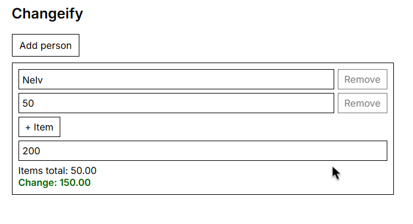

# [Changeify](https://nelvismyname.github.io/Changeify)
Change Calculator so your friends don't rip you off.

# Building
Changeify is barebones, and simple. Code is pretty much common sense
```
git clone https://github.com/nelvismyname/Changeify.git
```

## Star History
<a href="https://www.star-history.com/?repos=nelvismyname%Changeify&type=date&legend=top-left">
 <picture>
   <source media="(prefers-color-scheme: dark)" srcset="https://api.star-history.com/chart?repos=nelvismyname/Changeify&type=date&theme=dark&legend=top-left" />
   <source media="(prefers-color-scheme: light)" srcset="https://api.star-history.com/chart?repos=nelvismyname/Changeify&type=date&legend=top-left" />
   
 </picture>
</a>